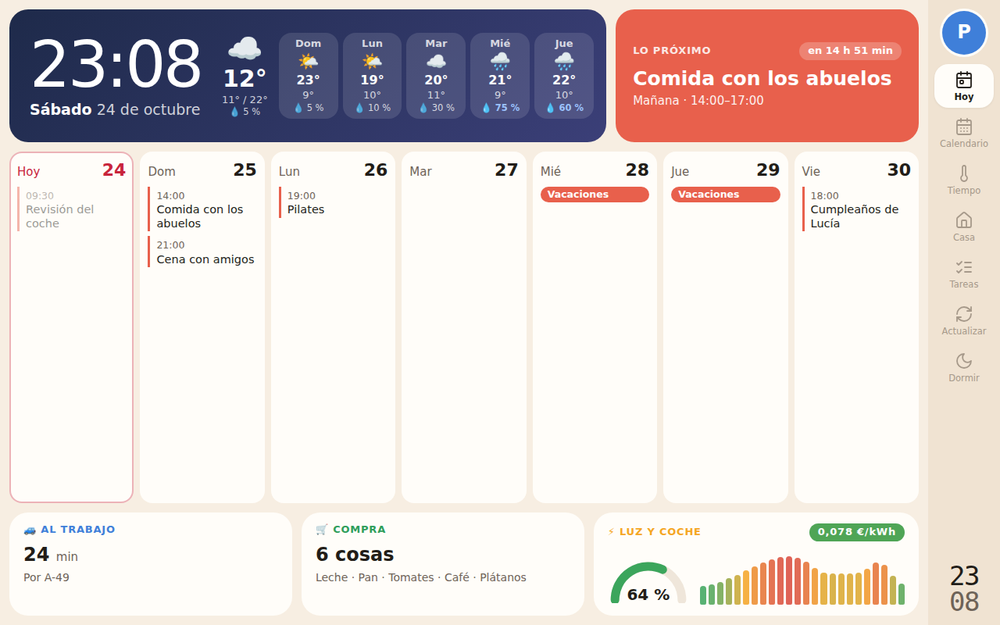
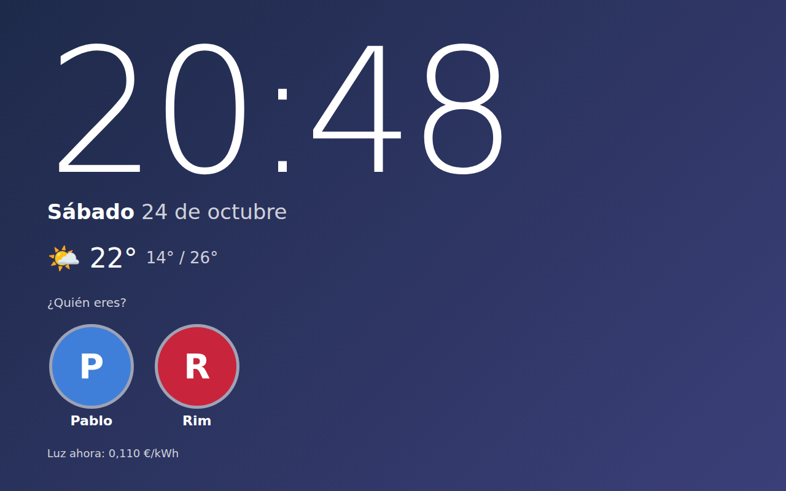

# Panel de cocina 🏠

Panel para la tablet de la cocina (Redmi Pad Pro): hora y tiempo, calendario compartido, lista de la compra, precio de la luz con las mejores horas para cargar el coche y poner el lavavajillas, el Tesla y el trayecto al trabajo de cada uno.

Corre como **un contenedor Docker en ZimaOS**. La tablet solo abre una web en modo quiosco. El calendario y las listas se siguen gestionando en **Calendario y Recordatorios de Apple**: el panel solo los enseña. Home Assistant hace de pegamento con el calendario, el coche y los trayectos, y los Recordatorios los envía un Atajo del iPhone, porque Apple no deja leerlos desde un servidor. La tablet nunca habla con Home Assistant: solo con este servicio.

Diseño y lógica basados en [eusonlito/Planify-Dashboard](https://github.com/eusonlito/Planify-Dashboard) y en su evolución [leontdi/marco-familiar-dashboard](https://github.com/leontdi/marco-familiar-dashboard). Ver [docs/DECISIONES.md](docs/DECISIONES.md) para saber qué se ha tomado de cada uno y por qué esto es una web y no una app Android.

<p align="center"></p>

## Cómo funciona

```
 Calendario de Apple «RIM Y PABLO» ─► HA: CalDAV ────────┐
 Tesla ─► HA: integración del coche ──────────────────────┤
 Trayectos ─► HA: Waze Travel Time (uno por persona) ─────┼─► panel-cocina (Docker, ZimaOS) ─► Redmi Pad Pro
 Recordatorios «Compra», «Casa» ─► Atajo del iPhone ──────┘      │                          (Fully Kiosk)
                                                                 ├─ Red Eléctrica: PVPC (sin clave)
                                                                 └─ Open-Meteo: tiempo (sin clave)
```

**Pantalla de bloqueo:** el cielo cambia de color con la hora del día, con el reloj, la fecha, el tiempo, el precio de la luz de ahora y los avatares. Tocar un avatar abre el panel. No hay PIN.

**Panel:** como el marco original, una barra a la derecha con una vista por sección. **Hoy**: hora y tiempo, lo próximo con cuenta atrás, los siete días siguientes y los resúmenes de trayecto, compra, luz y coche. **Calendario**: esta semana y la siguiente con el tiempo de cada día, el menú, los festivos, la F1 y los partidos del Madrid y del Barça ([docs/CALENDARIOS.md](docs/CALENDARIOS.md)); al tocar una cita o el menú se ve el detalle. **Tiempo**: la curva de temperaturas por horas y los próximos días. **Casa**: la calefacción (termostato y válvulas) con su consigna y modo, el aire acondicionado, la temperatura de cada estancia y la música del Echo de la cocina. **Energía**: luz con mejores horas, el Tesla y los trayectos de los dos. **Consumo**: lo que gasta la casa ahora (W y €/h), cada aparato y el consumo de hoy hora a hora con su coste. **Tareas**: las listas de Recordatorios y los ingredientes del menú semanal, que se pasan a la Compra tocándolos ([docs/MENU.md](docs/MENU.md)). **Dormir** vuelve a la pantalla de bloqueo. Tocando tu avatar, arriba a la derecha, vuelves al bloqueo, y lo hace solo tras 2 minutos sin tocar.

**Mejores horas:** busca el tramo de N horas seguidas más barato desde ahora, hoy o mañana: 4 h para el coche y 2 h para el lavavajillas y la lavadora. Solo lo recomienda si está por debajo de la media de su día. Por la noche, si aún no se conoce el precio de mañana, dice que mejor esperar (REE lo publica sobre las 20:30). También marca las 3 horas más caras que quedan hoy.

<p align="center"></p>

## Puesta en marcha

1. **Home Assistant:** las integraciones y el token. Ver [docs/HOME-ASSISTANT.md](docs/HOME-ASSISTANT.md).
2. **Recordatorios:** el Atajo del iPhone. Ver [docs/RECORDATORIOS.md](docs/RECORDATORIOS.md).
3. **Configuración:**
   ```sh
   cp .env.example .env                              # HA_TOKEN, PANEL_TOKEN y puerto
   cp config/config.example.yaml config/config.yaml  # URL de HA, coordenadas, entidades, usuarios, listas
   ```
4. **Arrancar en ZimaOS** (por SSH, en la carpeta del repositorio):
   ```sh
   docker compose up -d --build
   ```
   Abre `http://<ip-de-zimaos>:8090`. En `http://<ip-de-zimaos>:8090/api/salud` se ve qué fuente falla.
5. **Tablet:** ver [docs/TABLET.md](docs/TABLET.md).

Para desplegar desde GitHub con Portainer, sin entrar en el servidor: [docs/DESPLIEGUE.md](docs/DESPLIEGUE.md).

### Probarlo sin Home Assistant

Con datos de ejemplo, en cualquier ordenador:

```sh
pip install -r requirements.txt
cp config/config.example.yaml config/config.yaml
PANEL_CONFIG=config/config.yaml PANEL_DEMO=1 uvicorn app.main:app --port 8090
```

## Estructura

| Ruta | Qué es |
|---|---|
| `app/main.py` | Servidor (FastAPI): la API de solo lectura y la web |
| `app/sources.py` | Lectura de Home Assistant, Red Eléctrica y Open-Meteo |
| `app/energy.py` | PVPC y recomendaciones de horas (portado de `EnergyScreen.kt`) |
| `app/reminders.py` | Recibe y guarda las listas de Recordatorios que envía el Atajo |
| `app/calendarios.py`, `app/festivos.yaml` | Festivos de Madrid, Fórmula 1 y partidos de fútbol |
| `app/menu.py`, `app/recetario.yaml` | Menú semanal saludable, sus ingredientes y lo pasado a la Compra |
| `app/cache.py` | Caché con «stale-if-error»: si una fuente falla, se sigue viendo lo último |
| `app/demo.py` | Datos de ejemplo (`PANEL_DEMO=1`) |
| `web/` | La interfaz: HTML, CSS y JS sin compilar |
| `config/config.example.yaml` | Plantilla de configuración |
| `deploy/portainer-compose.yml` | Despliegue en ZimaOS con Portainer (imagen de GitHub) |
| `.github/workflows/` | Pruebas en cada rama e imagen al fusionar en `main` |
| `tests/` | `python -m pytest` |

## Seguridad

- `.env` y `config/config.yaml` están en `.gitignore`: el token de Home Assistant nunca va al repositorio.
- Conviene un **usuario de Home Assistant propio para el panel**, sin permisos de administrador, con su token de larga duración.
- Escriben dos cosas: `POST /api/recordatorios` (el Atajo, protegido con `PANEL_TOKEN`) y `POST /api/casa/…` (la tablet: consigna, modo y preset de la calefacción y el aire, y la música), que solo actúa sobre las entidades de `config.yaml` y con valores acotados. Todo está pensado para la red de casa: no lo publiques a internet. No lo publiques a Internet sin un proxy con autenticación delante.

## Pendiente

- Foto de cada persona en el avatar (ya admite `foto:` en la configuración) y fotos del Synology en la pantalla de bloqueo.
- Horario de pantalla (reloj nocturno con brillo bajo), con Fully Kiosk.
- Marcar productos de la compra como comprados desde la tablet (el Atajo los completaría en Recordatorios).
- Más cosas por persona: sus eventos destacados y sus recordatorios.
